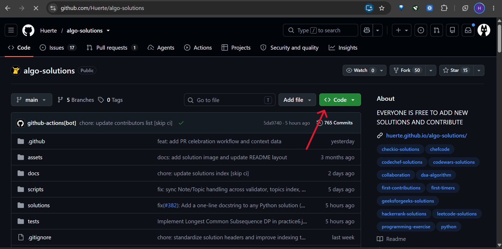
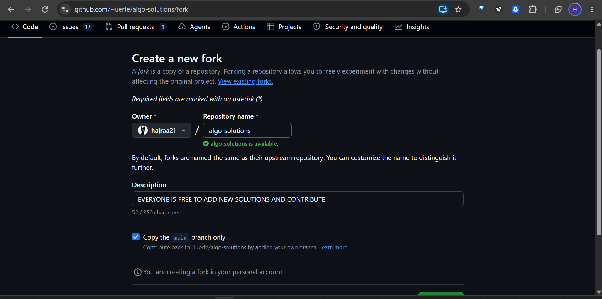
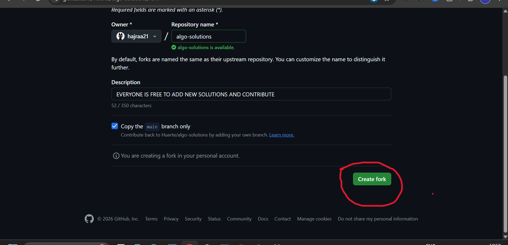
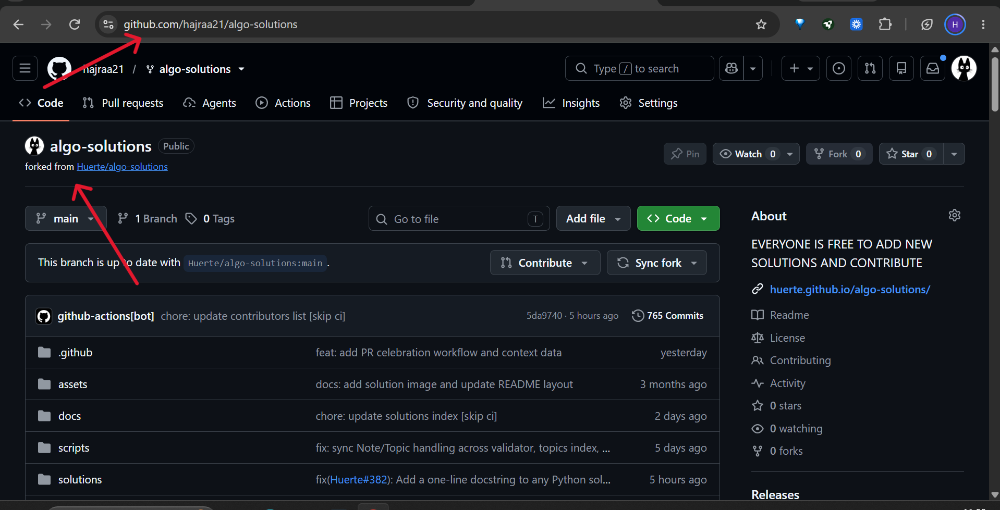
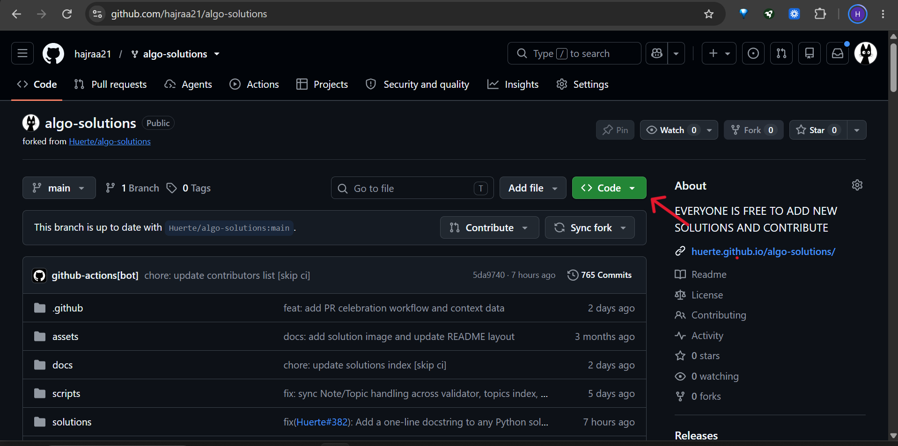
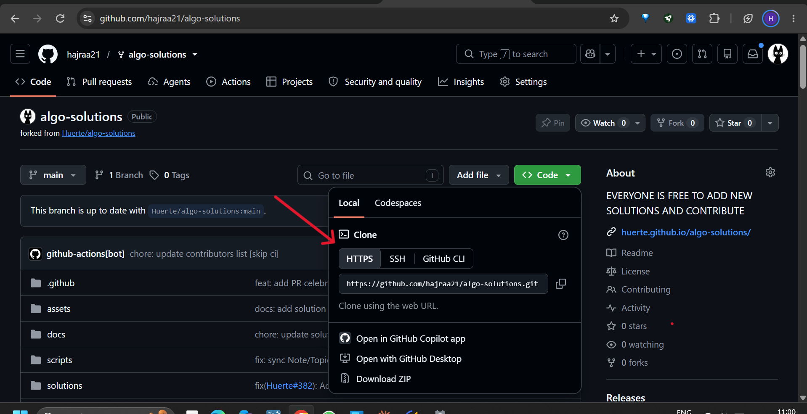
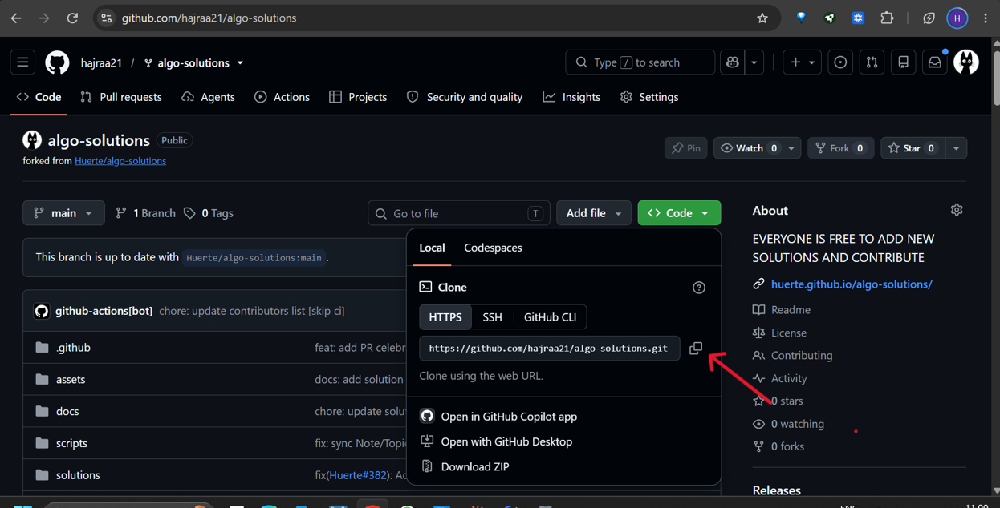
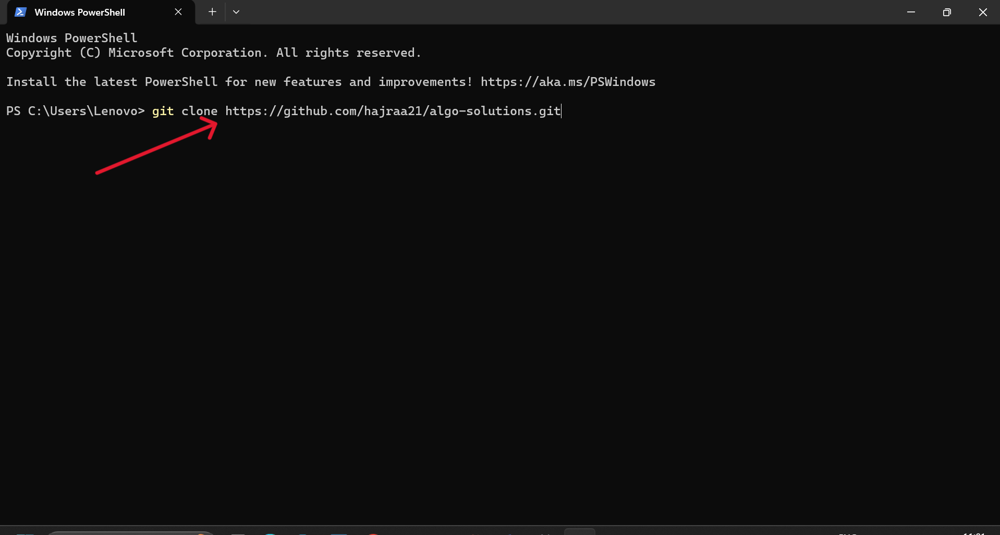
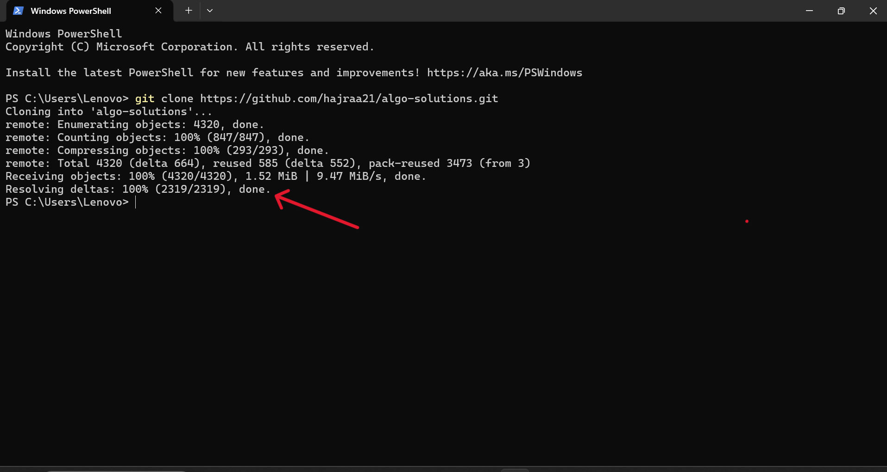
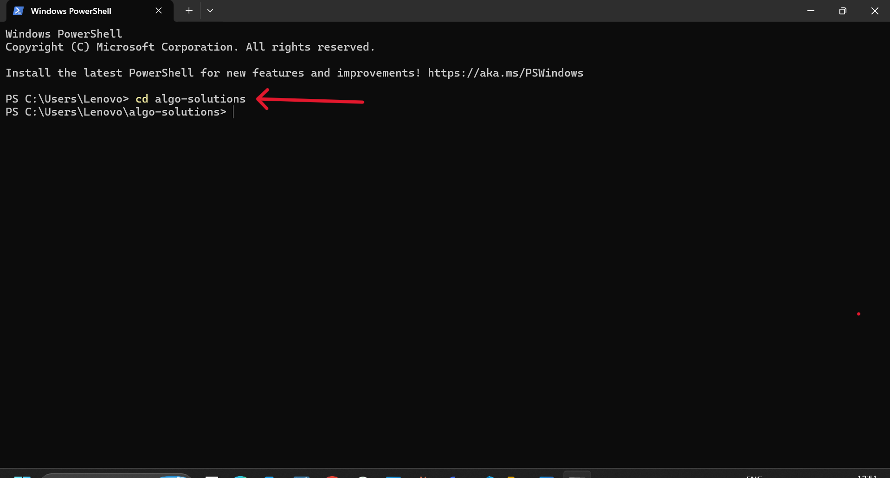

# Getting Started: Your First Contribution

This guide is for people who have never used Git or GitHub before. It is also for people who have never typed commands on a computer before.

You do not need to know anything about coding to follow this. Every single step is written out in full. If a step tells you to click something, it will say exactly where that thing is on the screen.

> Read each step fully before you do it. Do not skip ahead.

---

## Before You Start: What You Will Need

- A computer running Windows, Mac, or Linux
- An internet connection
- About 30 to 45 minutes of free time the first time you do this

That is all.

---

## Words You Will See in This Guide

These four words come up everywhere. Read this table once before you go further.

| Word | Simple Meaning |
|------|----------------|
| **Repository** (also called a **repo**) | A folder that holds all the files for a project. It lives on GitHub so anyone can see it and copy it. |
| **Fork** | A personal copy of someone else's repo that gets saved under your own GitHub account. You are free to change your fork however you want. Your changes will not touch the original until you ask the owner to accept them. |
| **Branch** | A separate workspace inside your fork. You make your changes in a branch so the main copy stays clean and untouched while you work. |
| **Pull Request** (also called a **PR**) | A message you send to the repo owner that says: "I made some changes in my fork. Please look at them and add them to the original." |

Here is how everything fits together:

```
Original Repo  (Huerte/algo-solutions)
       |
       |   You click "Fork"
       v
Your Fork      (your-username/algo-solutions)   <-- your personal copy on GitHub
       |
       |   You download it to your computer
       v
Your Computer  (a folder called algo-solutions)
       |
       |   You create a branch, make changes, save them
       v
Your Fork on GitHub gets updated
       |
       |   You open a Pull Request
       v
The original repo owner reviews and accepts your changes
```

---

## Step 1: Create a Free GitHub Account

GitHub is the website where the project lives. You need an account to contribute.

1. Open your web browser (Chrome, Firefox, Edge, Safari, or any other browser).

2. Go to this address: **https://github.com**

3. Look at the top-right corner of the page. Click the button that says **Sign up**.

4. GitHub will ask you for:
   - Your **email address** (use any email you have access to)
   - A **password** (make it at least 8 characters long)
   - A **username** (this is the name other people will see. Pick something you are happy with. You can use letters, numbers, and hyphens. Example: `maria-codes` or `john2025`)

5. GitHub will send a confirmation email to the address you entered. Open that email and click the confirmation link inside it.

   > If you do not see the email after a few minutes, check your Spam or Junk folder.

6. After confirming your email, sign in to GitHub with your username and password.

Your GitHub account is ready.

---

## Step 2: Install Git on Your Computer

Git is a free program that tracks changes you make to files. You need it on your computer to send your changes to GitHub.

GitHub is the website. Git is the program on your computer. They are different things and you need both.

---

### If You Are on Windows

1. Open your web browser and go to: **https://git-scm.com/download/win**

2. The download should start by itself. If it does not, click the link on the page that says **Click here to download manually**.

3. Once the file is downloaded (it will be named something like `Git-2.47.0-64-bit.exe`), double-click it to open the installer.

4. A setup window will open. Keep clicking **Next** on every screen. You do not need to change any of the options. The default settings work fine.

5. When you see the **Install** button, click it. Wait for it to finish.

6. Click **Finish** to close the installer.

7. Now open **Git Bash**. Here is how:
   - Press the **Windows key** on your keyboard (the key with the Windows logo on it).
   - Type `git bash` using your keyboard.
   - You will see a result called **Git Bash** appear. Click on it.
   - A black window with text will open. This is called a terminal. You will type commands here.

---

### If You Are on a Mac

1. Press `Cmd + Space` on your keyboard at the same time. This opens Spotlight Search.

2. Type `terminal` and press **Enter**. A white or black window will open with some text. This is the terminal.

3. Type this command exactly and press **Enter**:
   ```
   git --version
   ```

4. If Git is not installed yet, your Mac will show a popup that says something like "The 'git' command requires the command line developer tools." Click **Install** on that popup and wait for it to finish.

5. Once that finishes, type `git --version` again and press **Enter** to confirm it worked.

---

### If You Are on Linux

1. Open a terminal (search for "Terminal" in your applications).

2. Type one of the following commands, depending on your Linux type:
   - **Ubuntu or Debian:**
     ```
     sudo apt install git
     ```
   - **Fedora:**
     ```
     sudo dnf install git
     ```

3. It will ask for your password. Type it and press **Enter**. (You will not see the characters appear as you type. That is normal for Linux passwords.)

4. Wait for it to finish installing.

---

### How to Check That Git Is Installed

After installing (on any operating system), open your terminal and type this, then press **Enter**:

```
git --version
```

You should see a line of text like this:

```
git version 2.47.0
```

The numbers after `git version` might be different on your computer. That is fine. Any number means Git is installed and working.

If you see an error instead, go back and try the installation steps again from the beginning.

---

## Step 3: Tell Git Your Name and Email

Git needs to know who you are. When you save your work, Git will attach your name and email to it so the project history shows who made which change.

You only need to do this once. After this, Git remembers your details.

Open your terminal and type the first command below, then press **Enter**. Then type the second command and press **Enter**.

```
git config --global user.name "Your Name"
```

```
git config --global user.email "you@example.com"
```

Replace `Your Name` with your actual name. Keep the quotation marks around it.

Replace `you@example.com` with the email address you used to sign up for GitHub. Keep the quotation marks.

**Example of what it looks like after replacing:**

```
git config --global user.name "Maria Santos"
git config --global user.email "maria.santos@gmail.com"
```

There will be no confirmation message after each command. That is normal. The commands worked if no error appears.

---

## Step 4: Fork the Repository

Forking creates your own personal copy of the project on GitHub.

1. Open your web browser and go to:
   **https://github.com/Huerte/algo-solutions**

2. Make sure you are signed in to your GitHub account. You should see your username or profile picture at the top-right corner of the page.

3. Look near the top-right of the page, just below the main navigation bar. You will see three buttons: **Watch**, **Fork**, and **Star**. Click **Fork**.

   

4. A new page will appear titled "Create a new fork". You will see your username already selected under "Owner". Leave everything as it is.

   

5. Click the green **Create fork** button at the bottom.

   

6. GitHub will take a few seconds to create your fork. When it is done, you will be taken to a new page. The address in your browser will now say something like:
   ```
   https://github.com/your-username/algo-solutions
   ```
   

   You can also see it under the repo name as "forked from Huerte/algo-solutions".

   That is your fork. It is your copy.

---

## Step 5: Download Your Fork to Your Computer

This step is called "cloning." It downloads all the files from your fork onto your computer so you can work on them.

1. Make sure you are on your fork page. The address in your browser should show your username, not `Huerte`. If it does not, go to `https://github.com/your-username/algo-solutions` (replace `your-username` with your actual GitHub username).

2. Find the green button that says **Code** and click it. A small box will appear with a web address inside it.

   


3. Inside that box, make sure the tab that says **HTTPS** is selected (it is usually selected by default). The address will look like this:
   ```
   https://github.com/your-username/algo-solutions.git
   ```
   

4. Click the **copy icon** next to the address (it looks like two overlapping squares). The address is now copied to your clipboard.

   

5. Open your terminal (Git Bash on Windows, Terminal on Mac or Linux).


6. You need to decide where on your computer you want to save the project folder. The Desktop is a good choice if you are unsure. Type this command to go to your Desktop, then press **Enter**:
   ```
   cd Desktop
   ```
   > `cd` stands for "change directory." A directory is the same thing as a folder. This command moves you into the Desktop folder.


7. Now type `git clone ` (with a space at the end), then paste the address you copied in step 4. The full command will look like this:
   ```
   git clone https://github.com/your-username/algo-solutions.git
   ```
   Press **Enter**.

   

8. Git will download the files. You will see lines of text appearing. Wait until it finishes and shows a new line ready for input.

   

9. Now move into the downloaded folder by typing this command and pressing **Enter**:
   ```
   cd algo-solutions
   ```

   

You are now inside the project folder on your computer. Any git commands you type from here will work on this project.

---

## Step 6: Create a Branch

A branch is a separate workspace where you will make your changes. The reason you create a branch is so your changes are kept separate from the main files. If something goes wrong, the main files are not affected.

**Rule: Never make changes directly on the `main` branch.**

Type the following command and press **Enter**. Replace `my-first-contribution` with a short name that describes what you are doing:

```
git checkout -b my-first-contribution
```

**Examples of good branch names:**
- `add-python-two-sum`
- `add-javascript-palindrome`
- `fix-typo-in-readme`

Branch names cannot have spaces. Use hyphens (`-`) between words instead.

After pressing **Enter**, you will see a message like:
```
Switched to a new branch 'my-first-contribution'
```

That means it worked.

**To check which branch you are on** at any time, type:
```
git branch
```

You will see a list of branches. The one with a `*` symbol in front of it is the branch you are currently on.

---

## Step 7: Make Your Change

Now you will add your actual work. This example shows how to add a code solution, but the same steps apply if you are fixing a typo or making any other kind of change.

### Finding the right folder

The project organizes solution files by programming language. The folder structure looks like this:

```
algo-solutions/
└── solutions/
    ├── python/
    │   ├── practice1.py
    │   ├── practice2.py
    │   └── ...
    ├── javascript/
    │   └── practice1.js
    └── (other languages)
```

If you are adding a Python solution, your file goes inside `solutions/python/`.

### Figuring out what to name your file

1. Open the folder for your language and look at what files are already there.
2. Find the highest number. For example, if the last file is `practice440.py`, your new file should be named `practice441.py`.
3. If your language folder does not exist yet, create it. Name it with all lowercase letters (for example: `solutions/ruby/`). Your first file inside it will be `practice1.rb`.

For the full naming rules, see [CONTRIBUTING.md](../CONTRIBUTING.md#1-how-to-name-and-place-a-solution-file).

### Creating the file

Create a new file in the correct folder with the correct name. You can use any text editor you have (Notepad, VS Code, Notepad++, gedit, TextEdit, or any other).

### Writing the required header

Every solution file must start with a header at the very top. The header is just a few comment lines that say what problem you solved and where it came from.

**For Python (use `#` for comments):**
```python
# Problem: Two Sum
# Source: https://leetcode.com/problems/two-sum
# Topic: Hash Table, Arrays
```

**For JavaScript, Java, C++, Go, Rust (use `//` for comments):**
```javascript
// Problem: Two Sum
// Source: https://leetcode.com/problems/two-sum
// Topic: Hash Table, Arrays
```

After the header, add your solution code below it.

**Full Python example:**
```python
# Problem: Two Sum
# Source: https://leetcode.com/problems/two-sum
# Topic: Hash Table, Arrays

class Solution:
    def twoSum(self, nums, target):
        seen = {}
        for i, num in enumerate(nums):
            complement = target - num
            if complement in seen:
                return [seen[complement], i]
            seen[num] = i
```

Save the file when you are done.

For the full header format rules and more examples, see [CONTRIBUTING.md](../CONTRIBUTING.md#2-header-comment-format).

---

## Step 8: Save Your Changes with Git

After you save the file on your computer, you still need to tell Git about it. This takes three separate commands. Run them one at a time.

**Make sure your terminal is still inside the `algo-solutions` folder.** If you closed the terminal, open it again, go to where you saved the project, and type `cd algo-solutions` to get back inside.

---

### Command 1 of 3: Stage your changes

Staging means you are picking which files to include in your next save point.

```
git add .
```

The `.` at the end means "include all files I changed." There is a space between `add` and `.`.

If you want to include only one specific file instead of everything, type:
```
git add solutions/python/practice441.py
```
(Replace the filename with your actual filename.)

There will be no visible response after this command if it worked. That is normal.

---

### Command 2 of 3: Commit your changes

A commit is a saved snapshot of your work at this moment. You attach a short message to it so anyone reading the history can understand what changed.

```
git commit -m "Add Python solution for Two Sum (practice441)"
```

The part inside the quotation marks is your message. Write something short and clear that describes what you did.

After pressing **Enter**, you will see output like this:
```
[my-first-contribution abc1234] Add Python solution for Two Sum (practice441)
 1 file changed, 12 insertions(+)
```

That means the commit was saved successfully.

---

### Command 3 of 3: Push your changes

Pushing sends your commit from your computer up to your fork on GitHub.

```
git push origin my-first-contribution
```

Replace `my-first-contribution` with the branch name you chose back in [Step 6](#step-6-create-a-branch).

You will see some output ending with a line like:
```
Branch 'my-first-contribution' set up to track remote branch 'my-first-contribution' from 'origin'.
```

That means your changes are now on GitHub inside your fork.

---

## Step 9: Open a Pull Request

A Pull Request is how you officially ask for your changes to be added to the original project.

1. Open your web browser and go to your fork:
   ```
   https://github.com/your-username/algo-solutions
   ```
   (Replace `your-username` with your GitHub username.)

2. Near the top of the page, you will usually see a yellow or blue banner that says something like **"your-branch had recent pushes"** and a button that says **"Compare & pull request"**. Click that button.

   If you do not see that banner, do this instead:
   - Click the **Pull requests** tab near the top of the page.
   - Click the green **New pull request** button.
   - Find the dropdown that says **compare:** and select your branch name from the list.

3. You will now see a form. Check the following before continuing:
   - **base repository** should say `Huerte/algo-solutions`
   - **base** branch should say `main`
   - **head repository** should show your username
   - **compare** should show your branch name

4. Fill in the **Title** box. Write a short, clear title. For example:
   ```
   Add Python solution for Two Sum (practice441)
   ```

5. In the **description box** below the title, write a brief note about what you did. If you are working on a specific issue from the [issues list](https://github.com/Huerte/algo-solutions/issues), add this line to your description:
   ```
   Closes #142
   ```
   Replace `142` with the actual issue number. This links your PR to the issue automatically.

   For more tips on writing good PR titles and descriptions, see [CONTRIBUTING.md](../CONTRIBUTING.md#4-what-a-good-pull-request-title-looks-like).

6. Click the green **Create pull request** button.

Your Pull Request is now submitted. The project owner will be notified and will review your changes.

---

## Step 10: Responding to Review Comments

After you open a Pull Request, the project owner might leave comments asking you to change something small. This is a normal part of contributing.

Do not close your Pull Request and open a new one. Just make the changes and push again. Your existing Pull Request will update by itself.

Here is how:

1. Go back to the file on your computer and make the changes that were requested.

2. Save the file.

3. In your terminal (inside the `algo-solutions` folder), run these two commands again:

   ```
   git add .
   ```

   ```
   git commit -m "Fix: address review comments"
   ```

4. Push the update to GitHub:

   ```
   git push origin my-first-contribution
   ```

   Replace `my-first-contribution` with your branch name from [Step 6](#step-6-create-a-branch).

5. Go back to your Pull Request page on GitHub. The new commit will appear there automatically within a few seconds.

---

## Common Error Messages and What to Do

If something goes wrong, check this table first.

---

**Error: `git: command not found`**

Git is not installed, or your computer does not know where to find it.

Go back to [Step 2](#step-2-install-git-on-your-computer) and follow the installation steps again from the beginning.

---

**Error: `Permission denied (publickey)`**

This happens when Git is trying to connect using a method called SSH, but you have not set that up.

The fix: use HTTPS instead of SSH. When you clone, make sure the URL you copy starts with `https://` and not with `git@github.com`. If you already cloned using the wrong URL, delete the folder from your computer and go back to [Step 5](#step-5-download-your-fork-to-your-computer) and clone again using the HTTPS link.

---

**Error: `error: failed to push some refs`**

Your branch on your computer is out of date compared to what is on GitHub.

Run this command first:
```
git pull origin main
```

Then try pushing again:
```
git push origin my-first-contribution
```

---

**You see `CONFLICT` text in the terminal**

This means two people changed the same part of the same file at the same time, and Git does not know which version to keep.

Open the file that has the conflict. Look for lines that look like this:
```
<<<<<<< HEAD
your version of the line
=======
the other version of the line
>>>>>>> main
```

Delete the lines you do not want, including the `<<<<<<<`, `=======`, and `>>>>>>>` marker lines. Save the file. Then run:
```
git add .
git commit -m "Resolve merge conflict"
```

If this feels confusing, just leave a comment on your Pull Request or open a new issue and ask for help. Someone will walk you through it.

---

## Still Stuck?

You can ask for help in two ways:

- **On the issue you are working on:** Scroll to the bottom of the issue page and leave a comment with your question.
- **In a new issue:** Go to the [issues page](https://github.com/Huerte/algo-solutions/issues) and open a new issue. Write your question there.

There is no question too small. Everyone starts from zero at some point.

You can also re-read [CONTRIBUTING.md](../CONTRIBUTING.md) for a summary of the rules and guidelines for this project.
